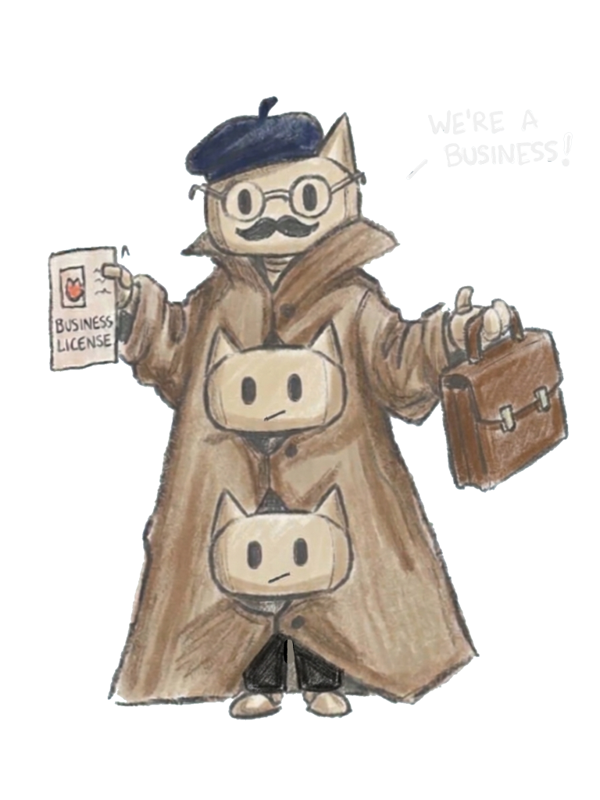

# crittertown


> a dark factory for ai agents: an org chart of long running workers, and a person at the
> top who is not managing it



## what this is building

crittertown is an intentionally assembled architecture for a multi-agent system that runs as
a dark factory: autonomous, self directed, self driving, long running ai workers carrying out
end to end operations with almost nobody in the loop.

the structure is a distributed hierarchical multi-agent system, an hmas, shaped like an org
chart, because an org chart is the oldest known answer to "how do a hundred workers finish
something without one person holding all of it". departments and wings hold teams, teams hold
agents, and the agents are a mixture of generalists and specialists. the hierarchy is not
decoration: it is how authority is intersected downward, how work is routed by capability
rather than by name, and how an escalation finds a person to ask.

the agents are the only first-class citizens. a person is not a node in the org chart. each
agent has its own cloud computer, its own tool capabilities and its own cryptographic
identity, so a claim it makes about work it did can be checked by someone who was not there.

the aim, stated plainly, is not a coworker and not a companion. crittertown is not built for
sitting beside a human in a shared document. it is built to take a problem end to end inside
the agent org chart and come back with the result. the human is the ubo, the ultimate
beneficial owner: hands off, holding the direction, the constraints and the money, and not
the day to day manager of anything.

the ubo is hands off because the agents hold the operations rather than borrowing a person's
authority each time they act. the org sits inside a contained legal entity, the way clawbank
was set up earlier this year: the entity is the thing that can hold an account, sign a
contract and carry the liability, and the agents run its operations under it. that is what
corporate personhood buys a dark factory. a worker that has to route every signature through
a human is a worker with a human in the loop, and the point of the arrangement is that the
human's role is ownership, not management. the containment is the other half: the entity is
bounded on purpose, so what the org can reach is a matter of the charter rather than a matter
of a prompt.

what that asks for, and what is being built here:

- **long horizon.** work outlives a context window, a session and a model. a card is a row,
  a run holds a lease, and the board remembers both
- **self improving.** a run that goes badly files a lesson, a person promotes it, and the
  promoted sentence goes into every later prompt. a lesson structurally cannot touch a limit
- **self regulating.** limits answer without a person, and a refusal is counted against the
  seat that earned it rather than described in a log
- **self remediating.** a dead holder, a silent run and a seat that renews forever are found
  by the sweep, not by a person noticing
- **proactive and reliable.** the next thing happens because a schedule or an event said so,
  and the morning brief carries the numbers that say whether it did
- **auditable.** every move is a row, the rows are hash chained and signed per agent, and the
  chain exports as a bundle anyone can verify offline
- **the lifecycle belongs to the project.** a project moves through inception, build,
  assemble, launch, operate and review, and it advances only when its phase is met. review
  has two exits and both are declared before the work starts: a metric that moved closes it,
  and a kill criterion that was written down while the sunk cost did not exist yet ends it.
  the seat is the smaller lifecycle, a live, frozen or burned agent that can be duplicated
  and retired without touching the work it was holding

## the name

the whole thing is a town: `critter.town`, `crittertown` in the code. the teams inside it
are still crews, and the slack-shaped place where people and crews talk is `basecamp`. the
town is the frame that holds several crews, one board and a set of machines; a crew is the
unit of work. `crittertown/glossary.md` keeps the words the api uses apart from the ones we
coined.

## the eight verbs

create, curate, cultivate, collect, connect, collaborate, coordinate, construct. one crew
is the whole list, and every verb maps to something in the tree. `crittertown/positioning/words/c.md`
has the table, and `w.md` beside it holds the nine w's: who, what, when, where, why,
why-not, world, way, wire, with the evidence for each and the gaps named.

## what is this

crittertown is a backend for teams of ai agents that actually finish things.

not "chat with an agent". a crew has agents with roles, skills and their own machines. it
has a board, rooms, an org chart, and shifts. work arrives as a card, gets picked up by
whoever is on duty, and shows up again in the morning brief with the numbers attached.

the thing i kept hitting with other agent stacks is that every one of them is a single
loop with a prompt in it. the moment the work is longer than a context window, or there
are two agents, or something needs a human to say yes, you end up being the scheduler.
crittertown is that scheduler, minus me.

## the shape

```
crew
 ├── agents ── computers (persistent, per agent) ── runs ── cards
 ├── board ── append only event log
 ├── rooms ── conversation + their own board
 ├── org chart ── coordinators, escalation, routing
 ├── seats ── roles, slices, freeze/thaw/duplicate/burn, dispatch by capability
 ├── projects ── phases with gates, two exit review, kill criteria
 ├── delegations ── handoffs as a state machine, breakdown into owned parts
 ├── convergence ── a barrier per fan out, so a parent waits on lanes not on hope
 ├── claims ── facts need references, plans may not be near certain
 ├── strikes ── two refusals freeze a seat, and a person clears it
 ├── crossings ── declared doors between crews, deny by default
 ├── budget ── a reservation, so a check and a claim are one act
 ├── shifts ── rotation, on duty, handoffs
 ├── intent ── direction, constraints, definition of done (read into every run)
 ├── routines ── recurring work with a receipt per day
 ├── guardrails ── the limits that answer without a person
 ├── lessons ── what a run taught, proposed and promoted by a person
 ├── knowledge ── preferences, facts, decisions, processes, patterns, failure modes
 ├── topology ── which structure a piece of work needs, decided from declared signals
 ├── evals ── a grid of scenarios by candidates, one scorer, one named winner
 ├── workflows ── dag, agent authored, human approved
 └── schedules ── durable queue, overnight brief
```

## what it does that most agent stacks don't

- **a card is a row, not a message.** every move is validated and appended, so the board
  is an audit log with a current state projection bolted on
- **a lease expires.** a holder that dies leaves an expiry instead of a card nobody can
  explain, and the sweep reclaims it without a reaper that remembers anything
- **renewing is not working.** output is recorded as its own fact, so a run that holds its
  lease while writing nothing for fifteen minutes gets a recovery card filed against it
- **a split is scoped, funded, staffed and doored.** a breakdown refuses an unowned part, a
  slice the project lacks, a frozen seat, a part leaving the crew without a declared
  crossing, and parts asking for more than the parent was given
- **who is working is arithmetic, not a stored fact.** `(now - anchor) // slot` picks the
  owner, so a duplicated beat cannot skew coverage and a missed beat cannot skip someone
- **approvals are links, not logins.** a gate opens with single use signed tokens and one
  tap decides it. no account, no dashboard visit
- **the night gets counted.** the brief computes numbers from rows, then checks every
  figure in its own prose against them before shipping
- **nothing is trusted to be true.** agents have principals, audit rows are hash chained
  and signed, exportable as a bundle anyone can verify offline
- **an agent never holds a key.** it gets a proxy url and the name of a variable its
  brokered token arrives in, plus the hosts it may reach

## under the hood

python, fastapi, sqlite. one process serves http, one drains the queue, one ticks. swap in a
broker when you need more. providers are your own iron first (local microvms, docker, ssh,
k8s, terraform) and somebody else's cloud only when you opt in.

the board is `manage`, self-hosted: projects, issues, and agents as members with an assignee
slot, so a crew and a person look the same to a project. a crew pulls from it by claiming a
run, and the board decides what woke it up.

## the parts

four roots, and the difference between them is who owns the thing:

```
ingredients/   baked in. the platform runs it and hands it to an agent by capability:
               machines/{persistent,ephemeral,hosted}, browser, schedule, durableobjects,
               workflows, projectmanagement/{manage,kanban}, credentials/credential-broker
toolbox/       called. someone else's daemon over its own api, never copied in: the two
               workflow engines, and firecrawl as the worked example of a tool an agent
               calls (scrape, crawl, map, through your own key)
workbench/     later: where an agent composes its own steps out of toolbox entries
infrastructure/ later: how the platform itself is deployed
```

an ingredient is named for what it does, not for the project it came from. `persistent` and
`ephemeral` are machines, `browser` is a page, `schedule` is the queue, `workflows` is a
flow, `manage` is the board, the credential broker is how an agent borrows a key without
holding one. `crittertown/thirdparty.md` is the one file that names upstreams, and it is also
the argued case for every licence here.

**an agent vm gets none of it.** the platform carries ingredients because the platform is
what runs them. an agent gets one computer and one transport, and asks the platform for the
rest. `docker build --target agent-vm` is the proof: there is no `ingredients/` in that
image, and a test asserts it.

## where things live

```
agents/ comms/ work/ org/ manage/ create/ sandbox/   the platform's own code
ingredients/                                        baked in, renamed for what it does
toolbox/                                            called over an api, never copied in
core/ api/                                          wiring and the http surface
crittertown/                                           glossary, docs, concept, credits, tests
theidea/                                            how it was assembled, and out of what
get/                                                how to run it, one folder per way in
configure.md                                        every env var, and what it does
```

## status

it runs, it is tested (1073 tests, no network, no sleeps), and it is honest about what is
not done. the runtime does not use every unit above yet: an agent to agent message carries no
claims and crosses no declared door, so a claim is only checked where a synthesis is written.
the shell shows ten views over 242 routes, so projects, strikes, claims, crossings and evals
have an api and no page. the postgres translation is tested for drift
rather than against a live server, and `tx()` will need a real advisory lock there. auth is
one shared token with no user model. and in `get/`, npm and mcp are honest placeholders.

`crittertown/docs/directive.md` covers what autonomy rests on: intent, routines, gates,
guardrails, lessons and the knowledge base.

## licence

apache-2.0. vendored client licences and provenance are in `crittertown/thirdparty.md`.
